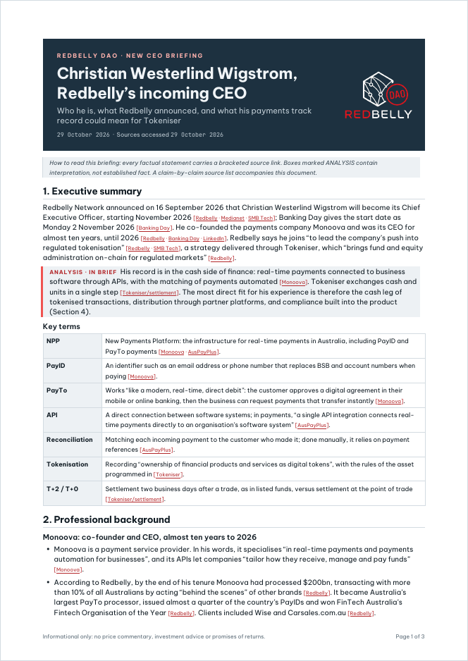
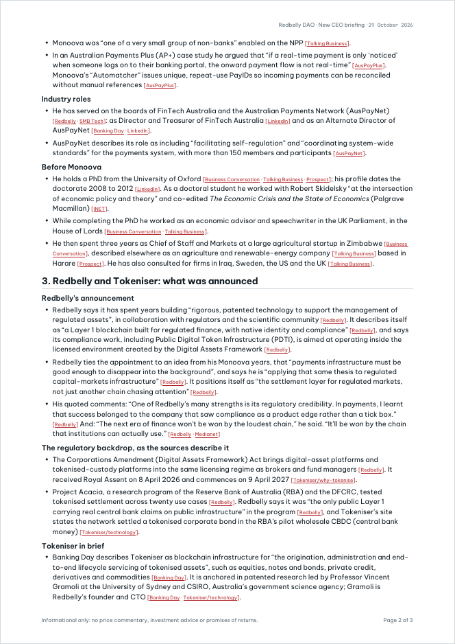
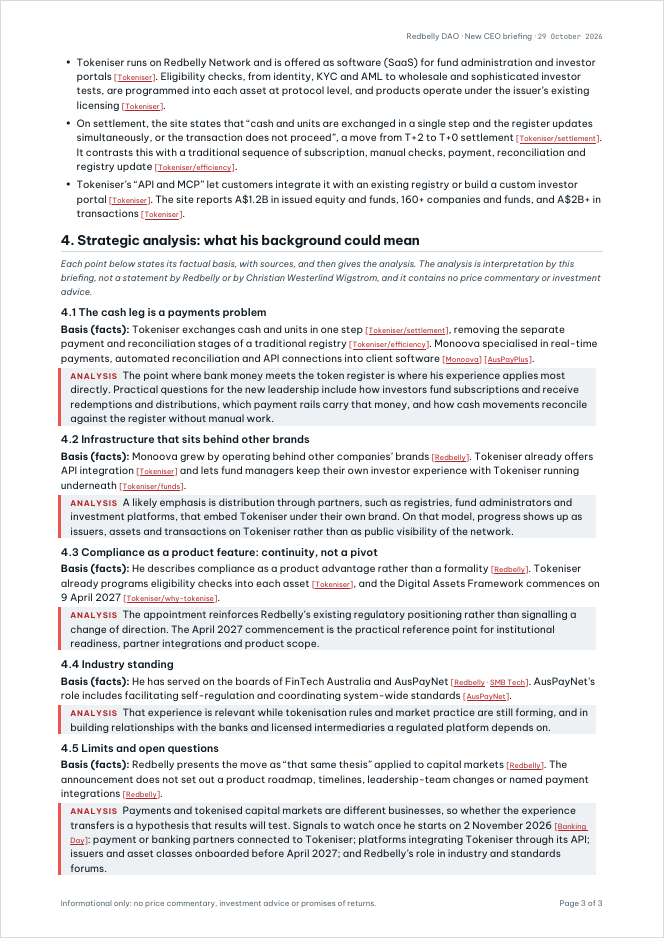

# New CEO Briefing: Christian Westerlind Wigstrom

A fully sourced briefing on Redbelly Network’s incoming Chief Executive Officer and what his track record suggests for Tokeniser. It comes with an X thread ready to post and a source list that ties every claim to a source. Submitted for [Redbelly DAO TASK-28](https://taskboard.redbellydao.network/tasks/TASK-28).

| Deliverables | Sources | Numbered claims | Automated checks | Sources accessed |
|:---:|:---:|:---:|:---:|:---:|
| 3 of 3 | 18 | 53 | 5 of 5 pass | 29 October 2026 |

<p align="center">
  <a href="01-briefing/new-ceo-briefing.pdf"></a>
  <a href="01-briefing/new-ceo-briefing.pdf"></a>
  <a href="01-briefing/new-ceo-briefing.pdf"></a>
</p>
<p align="center"><sub>The three-page briefing. Select a page to open the PDF.</sub></p>

## Deliverables

| # | Deliverable | Length | Main file | Other formats |
|---|---|---|---|---|
| 1 | Briefing | 3 pages, A4 | [`new-ceo-briefing.pdf`](01-briefing/new-ceo-briefing.pdf) | [Word](01-briefing/new-ceo-briefing.docx) · [Markdown](01-briefing/new-ceo-briefing.md) |
| 2 | X thread | 8 posts, 215 to 276 characters each | [`x-thread.md`](02-x-thread/x-thread.md) | [Plain text for posting](02-x-thread/x-thread.txt) |
| 3 | Source list | 18 sources, 53 claims with verbatim excerpts, LinkedIn screenshots | [`source-list.md`](03-source-list/source-list.md) | [PDF](03-source-list/source-list.pdf) · [Word](03-source-list/source-list.docx) |

The PDF and Word files follow the [Redbelly DAO Task Board brand kit](https://taskboard.redbellydao.network/brand): Be Vietnam Pro for all text, JetBrains Mono for IDs and dates, one red accent, and the DAO logo on a dark steel band. The Word files open directly in Google Docs (File > Open > Upload) if the DAO prefers a shared document.

## Briefing structure

| Section | Contents | Content type |
|---|---|---|
| 1. Executive summary | The appointment, his background in one paragraph, and a key terms table for readers new to payments | Fact, plus one box marked analysis |
| 2. Professional background | Monoova, industry board roles, and his career before Monoova | Fact |
| 3. Redbelly and Tokeniser | What Redbelly announced, the regulatory backdrop, and Tokeniser in brief | Fact |
| 4. Strategic analysis | Five points (4.1 to 4.5); each states its factual basis with sources, then gives the analysis | Fact, then marked analysis |

## How the task requirements are met

### Scope of work

| Requirement | Where it is met |
|---|---|
| Research his professional background from the public record | Briefing section 2; source list claims C15 to C32 |
| Summarise what Redbelly said when announcing the appointment | Briefing section 3; thread posts 1 and 6 |
| Explain what the background could mean, marked as analysis | Briefing section 4 and the boxes marked ANALYSIS; thread posts 7 and 8, labelled as analysis |
| Source every factual claim | Source list: each of the 53 claims has a link and the verbatim excerpt that supports it |
| Write a short version for X | Thread of 8 posts, each linking the source for the facts it states |

### Quality benchmarks

| Benchmark | How it is met |
|---|---|
| Every factual claim has a working source link | All 18 source links work. 17 pass an automated check (HTTP 200). LinkedIn blocks all automated requests (HTTP 999), so it was checked by hand in a browser on 29 October 2026. |
| Facts and analysis are clearly separated | Interpretation appears only in boxes marked ANALYSIS. In section 4, each point gives its facts first under “Basis (facts)”. |
| Readable by someone new to him or to payments | Plain language throughout, and a key terms table explains NPP, PayID, PayTo, API, reconciliation, tokenisation and T+2 / T+0. |
| Neutral, professional tone | Company figures are attributed (“According to Redbelly”, “The site reports”), and section 4.5 sets out the limits of the analysis and the open questions. |

### Failure criteria

| Criterion | Safeguard |
|---|---|
| Claim without a source, or with a source that does not support it | Every claim is numbered and paired with a verbatim excerpt from its source. Checks 1 and 2 confirm every factual line links a registered source. |
| Private life or anything outside the professional record | Scope is limited to roles, companies and published work. Personal details found in some sources were excluded on purpose (source list, section D). Check 5 scans for private-life terms. |
| Invented or unsourced quotes | Check 3 confirms every quotation appears word for word in a source excerpt. His quotes come only from the announcement, a Monoova interview and an AP+ case study. |
| Price talk, investment advice and promises of returns | None in any deliverable. Check 5 scans the briefing, the thread, the source list and this file. |
| Unchecked or invented content | Every source was opened and read on the access date, and every claim was checked against it. The supporting excerpt is quoted so any claim can be confirmed in seconds. |
| Personal credit inside the deliverable | No names, handles, signatures, watermarks or credit lines. The author field of every PDF and Word file reads “Redbelly DAO TASK-28”. |

## Source policy

1. **Task resources first.** The six resources listed in the task brief (S1 to S11, with each Tokeniser page listed separately) support most claims.
2. **Supplementary public record only where needed.** Seven further public sources (S12 to S18) cover facts the task resources do not: his Oxford PhD, his UK Parliament and Zimbabwe roles, Monoova’s payments specialism and AusPayNet’s remit. They are labelled *Supplementary* in the source list.
3. **Where sources differ, the briefing states only what they agree on.** For example, sources give different months for the end of his Monoova tenure, so the briefing says “until 2026”.
4. **Company figures are attributed, not presented as audited.** Monoova figures come from Redbelly’s announcement and Tokeniser figures from Tokeniser’s own site.

## Verification

`verification/verify.py` reads only the published files, so it checks exactly what a reviewer sees. Latest run, 29 October 2026:

| # | Check | Result |
|---|---|---|
| 1 | Every link is a registered source, and every source is cited | PASS |
| 2 | Every factual line in the briefing has a source link (31 lines) | PASS |
| 3 | Every quotation appears verbatim in a source excerpt (32 quotations) | PASS |
| 4 | Thread has 5 to 8 posts, each within 280 characters and linking a source | PASS |
| 5 | No price talk, private-life terms or personal credits | PASS |

Run the checks:

```bash
python3 verification/verify.py
```

Also check every source link and save the report:

```bash
python3 verification/verify.py --online --write
```

The script exits with status 1 if any check fails. Link results are reported but never fail the run, because some publishers refuse automated requests. The full report, including the HTTP status of each source, is in [`verification/verification-report.md`](verification/verification-report.md).

## Known limits

| Limit | How it is handled |
|---|---|
| Banking Day is partly paywalled | Only text from the free, visible portion is cited. |
| LinkedIn shows a reduced profile when logged out and blocks scripts | Used only for the About line, the Education entry and his own posts listing board roles. All four facts were confirmed by hand in a logged-in browser on 29 October 2026; cropped screenshots are in section E of the source list. |
| Sources give different months for the end of his Monoova tenure (July and May) | The briefing states only “until 2026”. |
| Sources describe his PhD field differently | The briefing states only that he holds a PhD from the University of Oxford. |

Full notes are in section D of the [source list](03-source-list/source-list.md).

## Rebuilding the deliverables

Every sentence, source, claim and excerpt lives in one file, [`build/content.js`](build/content.js). The build stops if any citation in the text does not match the sources recorded for that claim.

Requirements: Node.js 18 or later, LibreOffice (`soffice`), Poppler (`pdftoppm`, for the page previews), Python 3 with Pillow, and the fonts Be Vietnam Pro and JetBrains Mono (both free on Google Fonts). The build stops with a message if either font is missing.

```bash
cd build && npm install && cd ..
```

```bash
bash build/build.sh
```

`build.sh` generates the Word and Markdown files with docx 9.7.1, exports the PDFs with LibreOffice, renders the page previews shown above, then runs the offline checks and saves the report. To add the link status table to the saved report, run `python3 verification/verify.py --online --write` afterwards.

## Repository layout

```text
01-briefing/       briefing as PDF, Word and Markdown; preview/ holds the page images
02-x-thread/       thread as formatted Markdown and plain text for posting
03-source-list/    claim-by-claim source list as Markdown, PDF and Word; evidence/ holds the LinkedIn screenshots
verification/      verify.py and the latest report
build/             content.js (single source), build.js, build.sh, assets/ (DAO logos from the brand kit)
```

---

Informational only: no price commentary, investment advice or promises of returns.
